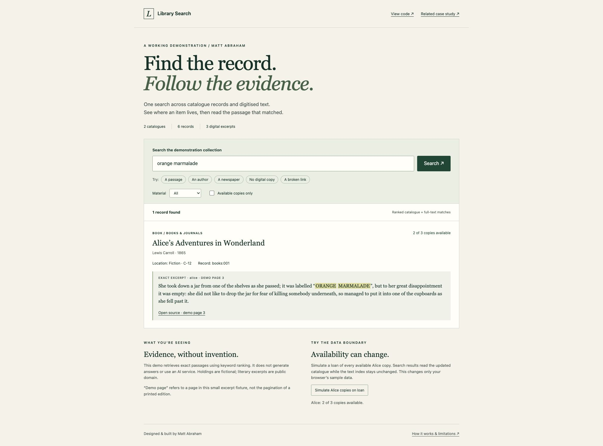
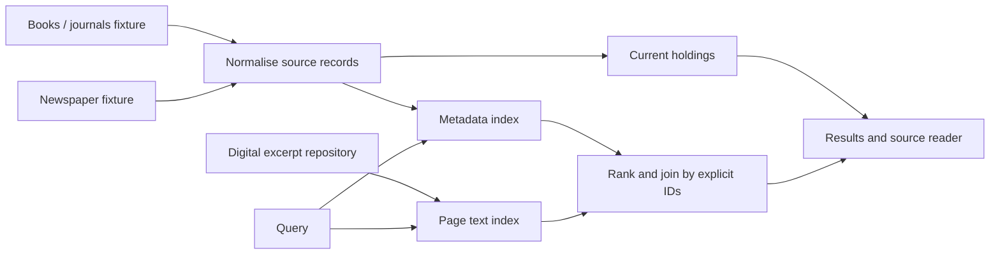

# Library Search

**[Try the live demo](https://tbmattnz.github.io/library-search/)** · **[Read the commercial library case study](https://github.com/tbmattnz/product-case-studies/blob/main/library.md)**

A small, working demonstration by Matt Abraham: search two catalogue formats and linked digitised text, inspect exact page references, and see current physical holdings.



**This is real keyword retrieval over small fixtures, not an AI answer simulation.** It uses BM25 scoring, no model, embeddings, Qdrant instance or external API. It is original sample code; Teacher’s Buddy’s commercial source remains private.

## Try it

1. Search **orange marmalade**. The phrase appears in a digitised excerpt, not catalogue metadata. Open its source to verify demo page 3.
2. Search **Jane Austen**. The catalogue matches; the result explicitly says the excerpt did not match. No content citation is invented.
3. Search **reading room** to retrieve a newspaper from a differently shaped catalogue.
4. Search **coastal botany** for a record with no digital copy, or **harbour** to see a broken digital link alongside genuine text results.
5. Return to **orange marmalade**, enable “Available copies only”, then simulate Alice copies on loan. Results update without rebuilding the text index.
6. Search **quantum entanglement**. The system returns no matching evidence.

All catalogue holdings are fictional. Novel excerpts are public domain; the newspaper excerpt is original CC0 sample text. **Demo page numbers refer to the excerpt fixture, not a printed edition.** See [source provenance](SOURCES.md).

## Run locally

Node.js 22 or newer. No installation, dependency download, API key or build step.

```sh
git clone https://github.com/tbmattnz/library-search.git
cd library-search
npm start
```

Open http://127.0.0.1:4318. Run `npm test` for the automated checks.

## Architecture



| File                   | Responsibility                                                                |
| ---------------------- | ----------------------------------------------------------------------------- |
| `docs/data.mjs`        | Two catalogue shapes, explicit digital links and page excerpts                |
| `docs/search.mjs`      | Normalisation, BM25 ranking, current-holdings filters and citation resolution |
| `docs/app.mjs`         | Browser interaction, safe text rendering and source reader                    |
| `server.mjs`           | Loopback-only static server with an explicit asset allowlist                  |
| `test/search.test.mjs` | Behavioural and HTTP tests                                                    |

The same retrieval module runs in the browser and in Node tests. Source namespaces keep identical IDs from different catalogues distinct. Explicit digital identifiers join records to content; similar titles never silently establish a link. Inputs are read without mutation. Missing files remain visible as catalogue records.

Metadata and page text are scored separately; the result score is twice the metadata BM25 score plus the best matching page score. Up to three matching pages are shown per record. This is a transparent heuristic for the fixture, not a calibrated relevance model. It combines two lexical indexes, **not semantic hybrid search**. Queries use OR matching after English stopword removal; results show actual matching terms.

Availability comes from the current in-memory catalogue. The button simulates an independent holdings update; it does not implement a real circulation API or multi-user synchronisation. Rebuilding metadata changes requires rebuilding the index.

## Checks

Twelve tests cover identifier collisions, unchanged source data, page-level citation resolution, metadata-only matches, newspaper joins, absent/broken links, holdings updates without text reindexing, filters, empty/unknown queries, deterministic ranking, invalid identifiers and the local server’s file/method boundaries.

## Scope

The sample demonstrates a small part of a library search architecture. It is not a production RAG system and makes no claim about 400,000-record performance, Georgian-language quality, OCR accuracy or zero hallucination.

Production work would add authenticated read-only source adapters, export validation, incremental indexing, OCR quality checks, access enforcement, a scalable search store, multilingual evaluation, monitoring and operational recovery. Sierra, DSpace, Greenstone, MARC21, Z39.50 and OAI-PMH are not implemented here. All fixture data is public and downloaded by the browser; material filters are not security boundaries.

No requests leave the page during search. Following source or portfolio links navigates to those sites. There are no analytics, accounts or persistent storage.

## About

I personally designed and built Teacher’s Buddy and Kitenga. This original demonstration accompanies my [library case study](https://github.com/tbmattnz/product-case-studies/blob/main/library.md).

[GitHub profile](https://github.com/tbmattnz) · [More product work](https://github.com/tbmattnz/product-case-studies)

Code: MIT. Fixture licensing: [SOURCES.md](SOURCES.md).
